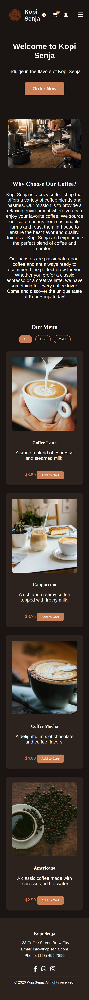

# Kopi Senja ☕

A responsive coffee shop landing page with a shopping cart and WhatsApp checkout. Built with plain HTML, CSS, and JavaScript (no frameworks) as a hands-on learning project.

**🔗 Live demo:** https://kopi-senja-pearl.vercel.app

## Preview

| Desktop                             | Mobile                            | Dark mode                     |
| ----------------------------------- | --------------------------------- | ----------------------------- |
|  |  |  |

## Features

- **Fully responsive** on desktop and mobile (media queries, Flexbox, CSS Grid)
- **Fixed navbar** with smooth scrolling to each section
- **Hamburger menu** on mobile that closes when you click outside
- **Dark mode** with the preference saved in the browser (`localStorage`)
- **Menu rendered from data** (array of objects) with **Hot / Cold filtering**
- **Shopping cart**: add, remove, and adjust quantities, with a live total that persists after a page refresh
- **WhatsApp checkout**: the cart is turned into a ready-to-send order message

## Tech Stack

- HTML5
- CSS3 (Flexbox, Grid, media queries, transitions)
- JavaScript (DOM manipulation, event listeners, array methods, `localStorage`)
- Font Awesome
- Deployed on Vercel

## What I Learned

- Building a responsive layout from scratch for both mobile and desktop
- Managing simple application state (the cart) and persisting it in the browser
- Rendering UI from data with `forEach`, `filter`, `map`, and template literals
- A Git and GitHub workflow with automatic deployment to Vercel

## Run Locally

```bash
git clone https://github.com/fadlydjannatin-droid/kopi-senja.git
cd kopi-senja
```

Then open `index.html` in your browser (or use the Live Server extension in VS Code).

## Roadmap

- Rupiah pricing with local number formatting
- Contact form
- Product detail pages

## Contact

Built by **Mohammad Fadly Djannatin**
GitHub: [@fadlydjannatin-droid](https://github.com/fadlydjannatin-droid)
